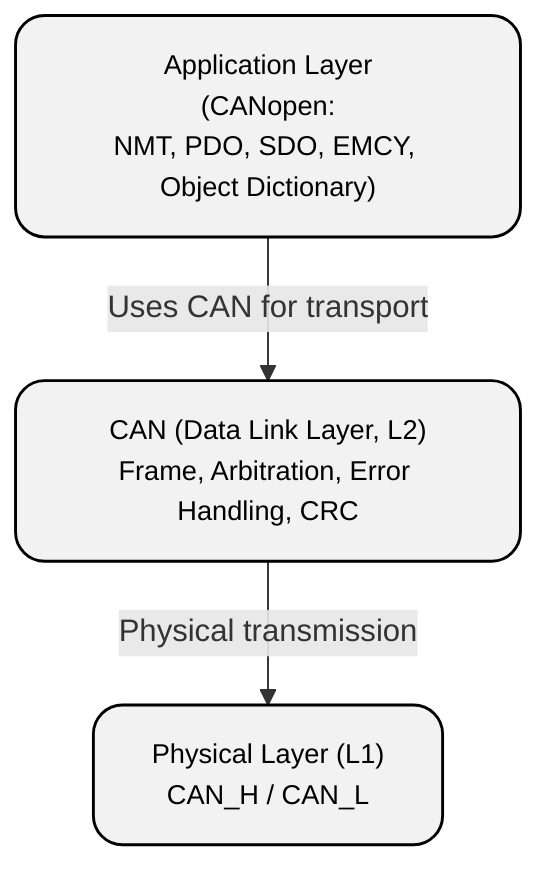

# CAN Protocol

## Purpose and Scope

A CAN bus, or **CAN (Controller Area Network)**, is an industrial serial network standard designed to exchange data between microcontrollers and devices without using a central computer (multi-master). The standard is defined by ISO (ISO 11898).

**Key idea**: multiple devices share a single differential line and arbitrate among themselves to determine which one transmits first. In this arrangement:

- there are no collisions that result in frame loss;
- message priority is determined by its identifier;
- errors are detected by hardware;
- a faulty node is automatically isolated.

**Areas of application** include automotive systems (ABS, engine control), aviation, satellite systems (CubeSat, LEO constellations), industrial automation, and elevator equipment.

## OSI Model Layers

In its classic form, the CAN protocol describes only the two lowest layers of the OSI model:

- **Physical Layer** — defines the electrical transmission parameters, signal levels (CAN_H and CAN_L), and requirements for the physical medium.
- **Data Link Layer** — defines the frame format, arbitration mechanism, error detection and handling, and access control for the shared bus.

## Standard CAN 2.0A Frame Structure

The simplified structure of a standard frame is shown in the diagram. Each field represents a separate stage in the lifecycle of a message on the CAN bus.

<!-- HTML -->
<svg width="900" height="80" viewBox="0 0 900 80" xmlns="http://www.w3.org/2000/svg">
  <defs>
    <marker id="arrowhead" markerWidth="10" markerHeight="7" refX="0" refY="3.5" orient="auto">
      <polygon points="0 0, 10 3.5, 0 7" fill="#666" />
    </marker>
  </defs>
  
  <g transform="translate(10, 20)">
    <rect width="50" height="40" rx="5" /> <text x="25" y="20">SOF</text>
    <line x1="50" y1="20" x2="65" y2="20" stroke="#666" marker-end="url(#arrowhead)" />
    <g transform="translate(75, 0)">
      <rect width="80" height="40" rx="5" /> <text x="40" y="20">Arbitration</text>
      <line x1="80" y1="20" x2="95" y2="20" stroke="#666" marker-end="url(#arrowhead)" />
    </g>
    <g transform="translate(180, 0)">
      <rect width="70" height="40" rx="5" /> <text x="35" y="20">Control</text>
      <line x1="70" y1="20" x2="85" y2="20" stroke="#666" marker-end="url(#arrowhead)" />
    </g>
    <g transform="translate(275, 0)">
      <rect width="60" height="40" rx="5" /> <text x="30" y="20">Data</text>
      <line x1="60" y1="20" x2="75" y2="20" stroke="#666" marker-end="url(#arrowhead)" />
    </g>
    <g transform="translate(360, 0)">
      <rect width="50" height="40" rx="5" /> <text x="25" y="20">CRC</text>
      <line x1="50" y1="20" x2="65" y2="20" stroke="#666" marker-end="url(#arrowhead)" />
    </g>
    <g transform="translate(435, 0)">
      <rect width="50" height="40" rx="5" /> <text x="25" y="20">ACK</text>
      <line x1="50" y1="20" x2="65" y2="20" stroke="#666" marker-end="url(#arrowhead)" />
    </g>
    <g transform="translate(510, 0)">
      <rect width="50" height="40" rx="5" /> <text x="25" y="20">EOF</text>
      <line x1="50" y1="20" x2="65" y2="20" stroke="#666" marker-end="url(#arrowhead)" />
    </g>
    <g transform="translate(585, 0)">
      <rect width="90" height="40" rx="5" /> <text x="45" y="20">Intermission</text>
    </g>
  </g>
</svg>
<!-- /HTML -->

Table 1 — Standard frame fields in detail

<table class="custom-table">
    <tr>
        <th style="text-align: center; vertical-align: center;">Field</th>
        <th style="text-align: center; vertical-align: center;">Size (bits)</th>
        <th style="text-align: center; vertical-align: center;">Description</th>
    </tr>
    <tr>
        <td>SOF (Start of Frame)</td>
        <td>1</td>
        <td><strong>Start of frame.</strong> A dominant bit ("0") that provides hard synchronization for the oscillators of all network nodes.</td>
    </tr>
    <tr>
        <td>Arbitration Field</td>
        <td>12</td>
        <td><strong>Arbitration field.</strong> Contains the 11-bit identifier (ID) and the RTR bit. Determines message priority when multiple nodes attempt to access the bus simultaneously. <i>The RTR bit is used to request data from another node. In a data frame, it is dominant ("0").</i></td>
    </tr>
    <tr>
        <td>Control Field</td>
        <td>6</td>
        <td><strong>Control field.</strong> Contains the IDE bit (0 for Standard), the reserved r0 bit, and the 4-bit DLC (Data Length Code), which specifies the number of data bytes.</td>
    </tr>
    <tr>
        <td>Data Field</td>
        <td>0–64</td>
        <td><strong>Data field.</strong> The message payload (from 0 to 8 bytes).</td>
    </tr>
    <tr>
        <td>CRC Field</td>
        <td>16</td>
        <td><strong>Checksum.</strong> A 15-bit sequence used to verify frame integrity, followed by a 1-bit recessive delimiter (CRC Delimiter).</td>
    </tr>
    <tr>
        <td>ACK Field</td>
        <td>2</td>
        <td><strong>Acknowledgment field.</strong> Consists of the ACK Slot (receivers drive it to "0" when the CRC is valid) and a recessive delimiter (ACK Delimiter).</td>
    </tr>
    <tr>
        <td>EOF (End of Frame)</td>
        <td>7</td>
        <td><strong>End of frame.</strong> A fixed sequence of 7 recessive bits ("1") indicating that the transaction is complete.</td>
    </tr>
    <tr>
        <td>Intermission</td>
        <td>3</td>
        <td><strong>Interframe space.</strong> The minimum waiting period before the next arbitration cycle can begin.</td>
    </tr>
</table>

{}
Note that the physical frame on the bus may contain a few additional bits because the controller inserts [stuff bits](#error-detection-and-handling-mechanism) for synchronization (after every sequence of five identical bits). The receiver removes these bits, and they are not considered part of the logical frame structure.
{}

## Arbitration Mechanism

The CAN bus access mechanism is based on the **CSMA/CR (Carrier Sense Multiple Access with Collision Resolution)** algorithm — a multiple-access method with carrier sensing and collision resolution:

- The bus has two states: **dominant (0)** and **recessive (1)**. A zero always "wins" over a one.
- If two nodes start transmitting simultaneously, they compare their IDs bit by bit.
- As soon as a node transmits a "1" but reads a "0" on the bus (transmitted by another node), it recognizes that it has lower priority and immediately switches to receive mode.
- **Result:** the node with the lowest numerical ID has the highest priority and transmits its data without delay.

**Design implication:** the identifier scheme must be developed during the system architecture phase because it determines message priorities.

## Error Detection and Handling Mechanism

CAN is considered one of the most reliable bus systems because it uses five error-checking mechanisms:

- **Bit Monitoring** — a node reads back the signal it transmits to the bus. If the levels do not match, an error is detected.
- **Bit Stuffing** — an inverted bit is inserted after five consecutive identical bits to maintain synchronization.
- **CRC Check** — checksum verification.
- **Form Error** — validation of the frame structure (stop bits, etc.).
- **ACK Check** — if no node acknowledges reception, the transmitter detects an error.

CAN node states:

- **Error Active** — normal operating state;
- **Error Passive** — elevated error level;
- **Bus Off** — disconnected from the bus.

Nodes have error counters that track different types of errors (for example, bit errors, CRC errors, and others).

If the number of errors exceeds a critical threshold, the node enters the Bus Off state and automatically disconnects from the bus to avoid disrupting the operation of other network devices. In this state, the node stops transmitting data and cannot participate in arbitration until it completes the recovery procedure.

# CANopen Stack

## Purpose of the CANopen Stack

If CAN is the "the wiring and the way to shout", then **CANopen** is the "language and rules of communication". It is an application-layer protocol that standardizes how data (temperature, speed, commands) is organized and exchanged within a network.

## OSI Layers Used

CANopen implements the application layer of the OSI model.

**Application Layer** — defines the data structure, the device interaction model, service types (PDO, SDO, NMT, EMCY), as well as node addressing rules and the structure of the Object Dictionary.

CANopen does not replace the data link layer; it uses CAN as its transport. It standardizes the application-level device interaction model **on top of** the CAN frame transmission mechanism. The diagram below shows the layered interaction structure.

## Object Dictionary

The Object Dictionary (OD) is a table (database) in which each setting or variable is assigned an index:

- **Index (16 bits)** — the address of an entry (for example, 0x1000 — device type);
- **Subindex (8 bits)** — an additional level used to address elements of arrays or structures.

All communication on the network comes down to reading from or writing to these entries.

Table 2 — Typical index ranges

<table class="simple-table">
    <tr>
        <th style="text-align: center; vertical-align: center;">Range</th>
        <th style="text-align: center; vertical-align: center;">Purpose</th>
    </tr>
    <tr>
        <td>0x0000–0x0FFF</td>
        <td>Reserved</td>
    </tr>
    <tr>
        <td>0x1000–0x1FFF</td>
        <td>Communication Profile Area</td>
    </tr>
    <tr>
        <td>0x2000–0x5FFF</td>
        <td>Manufacturer Specific</td>
    </tr>
    <tr>
        <td>0x6000–0x9FFF</td>
        <td>Standardized Device Profile Area</td>
    </tr>
    <tr>
        <td>0xA000–0xFFFF</td>
        <td>Reserved</td>
    </tr>
</table>

## Communication Object Types

Four main mechanisms are used to transfer data:

- **SDO (Service Data Object)** — direct access to the Object Dictionary.

  Reliable (acknowledged), but slow. Used for configuration.

- **PDO (Process Data Object)** — fast data transfer without acknowledgment.

  Triggered by events (e.g., a timer or a data change). There are two types: TPDO (transmit) and RPDO (receive).

- **NMT (Network Management)** — commands for controlling node states (Start, Stop, Pre-operational).

- **Special Function Objects** — synchronization (SYNC), error messages (EMCY), and timestamps (TIME).

## Node Addressing (Node-ID)

Each device on the network is assigned a unique **Node-ID** (from 1 to 127). The value 0 is used for broadcast management messages.

Node addressing helps prevent identifier conflicts on the network. The main principles of node addressing are:

- CANopen addressing is based on a combination of the message type (Function Code) and Node-ID.
- The frame identifier (CAN ID) for an SDO request is calculated using the following principle: *COB-ID = Function Code + Node-ID*.

# Glossary

## CAN Protocol (Lower Layer)

**CAN (Controller Area Network)** — an industrial serial bus standardized by ISO 11898. It implements the physical and data link layers of the OSI model to exchange messages between nodes without a central controller.

**Physical Layer** — the first layer of the OSI model. Defines the electrical transmission parameters, CAN_H and CAN_L signal levels, synchronization, and requirements for the transmission medium.

**Data Link Layer** — the second layer of the OSI model. Defines the CAN frame format, arbitration mechanism, error detection, and bus access control.

**Identifier (ID)** — an 11-bit (Standard) or 29-bit (Extended) value that determines message priority on the CAN bus.

**Arbitration** — a mechanism for resolving simultaneous transmission attempts by multiple nodes. The message with the lowest numerical identifier wins.

**CSMA/CR (Carrier Sense Multiple Access with Collision Resolution)** — a multiple-access algorithm with carrier sensing and collision resolution, used in CAN.

**Dominant Bit** — a logical "0". At the physical layer, it is "stronger" and always overrides a recessive bit.

**Recessive Bit** — a logical "1". It is present on the bus only when no dominant bit is being transmitted.

**Bit Stuffing** — a synchronization method in which the controller automatically inserts one bit of the opposite polarity after five consecutive identical bits.

**CRC (Cyclic Redundancy Check)** — a method for verifying frame integrity using a 15-bit checksum.

**Error Active** — a CAN node state in which the error level is normal. The node can transmit and generate active error frames.

**Error Passive** — a node state entered when the error level is elevated. The node is restricted in its ability to generate active error signals.

**Bus Off** — a node state in which the device is disconnected from the bus due to a critical number of errors, preventing it from interfering with other nodes.

**RTR (Remote Transmission Request)** — a data request bit. It allows one node to request that another node send a specific message.

## CANopen Stack (Upper Layer)

**CANopen** — an application-layer protocol built on top of CAN that standardizes the data model, service types, and device interaction rules.

**Application Layer** — the seventh layer of the OSI model. In CANopen, it defines the data structure, Object Dictionary, and message exchange rules.

**Object Dictionary (OD)** — a structured table of parameters for a CANopen device, organized by 16-bit indices and 8-bit subindices.

**Index** — a 16-bit address of an entry in the CANopen Object Dictionary.

**Subindex** — an 8-bit extension of an index, used to access elements of an array or structure.

**SDO (Service Data Object)** — a mechanism for reliable access to the Object Dictionary with transfer acknowledgment.

**PDO (Process Data Object)** — a fast data transfer mechanism without acknowledgment, designed to exchange process variables.

**NMT (Network Management)** — a mechanism for managing CANopen node states (Start, Stop, Pre-operational).

**SYNC** — a synchronization message in CANopen that enables data to be updated simultaneously.

**EMCY (Emergency Message)** — an emergency notification message reporting a device error in CANopen.

**Node-ID** — a unique identifier of a CANopen device in the range 1–127.

---
